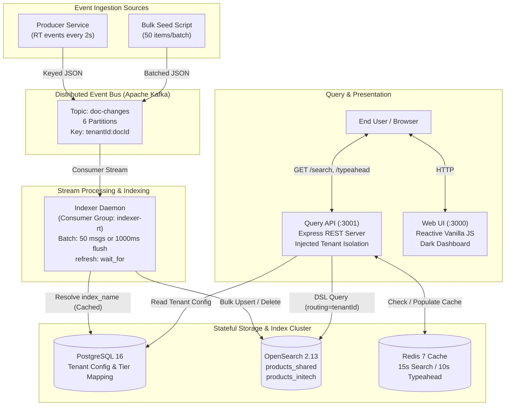
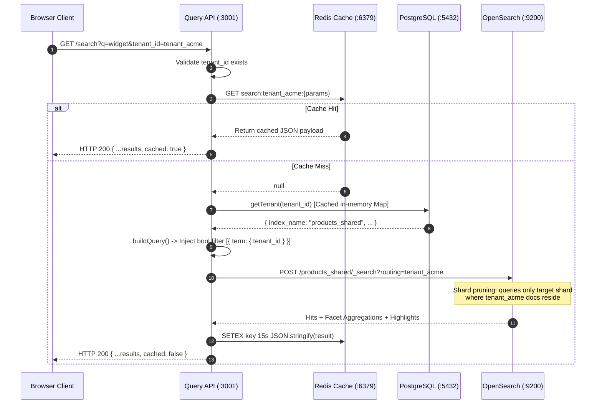
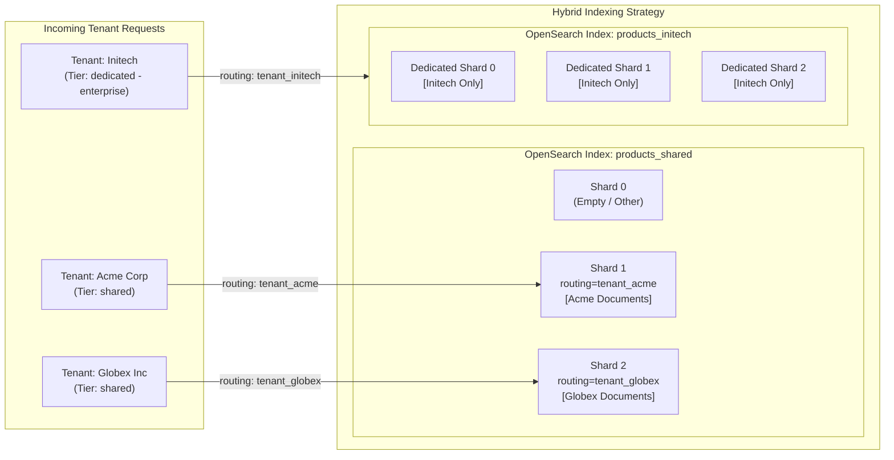

# Multi-Tenant Search & Indexing Platform

[](https://phenom.com)
[](#system-architecture)
[](https://opensearch.org/)
[](https://kafka.apache.org/)
[](https://www.postgresql.org/)
[](https://redis.io/)

> **Phenom Engineering · Hack to Hire 2.0 · Domain D MVP**  
> A high-throughput, near-real-time ($< 5\text{ s}$ SLA), isolated multi-tenant search and typeahead platform built with Kafka, OpenSearch, PostgreSQL, Redis, and Node.js.

---

## Table of Contents

- [1. Executive Overview & Problem Context](#1-executive-overview--problem-context)
- [2. System Architecture & Block Diagrams](#2-system-architecture--block-diagrams)
  - [2.1 End-to-End System Block Diagram](#21-end-to-end-system-block-diagram)
  - [2.2 Ingestion & Indexing Pipeline](#22-ingestion--indexing-pipeline)
  - [2.3 Query & Typeahead Request Flow](#23-query--typeahead-request-flow)
  - [2.4 Hybrid Multi-Tenant Storage Model](#24-hybrid-multi-tenant-storage-model)
- [3. Key Architectural Pillars](#3-key-architectural-pillars)
- [4. Component Breakdown](#4-component-breakdown)
- [5. Data Models & Analysis Pipeline](#5-data-models--analysis-pipeline)
  - [5.1 PostgreSQL Tenant Registry](#51-postgresql-tenant-registry)
  - [5.2 Kafka Event Schema](#52-kafka-event-schema)
  - [5.3 OpenSearch Edge-NGram & Schema Mapping](#53-opensearch-edge-ngram--schema-mapping)
- [6. API Reference Specification](#6-api-reference-specification)
- [7. Quick Start & Operational Runbook](#7-quick-start--operational-runbook)
- [8. Interview Demo Playbook (5-Minute Script)](#8-interview-demo-playbook-5-minute-script)
- [9. Technical FAQ & Design Decisions](#9-technical-faq--design-decisions)

---

## 1. Executive Overview & Problem Context

In large enterprise SaaS ecosystems, search platforms must serve thousands of heterogeneous organizations under one infrastructure roof. This MVP demonstrates practical solutions to the four classic multi-tenant search pitfalls:

1. **Cross-Tenant Data Leakage**: Injected server-side query filters guarantee zero data leakage between tenants.
2. **Indexing Lag vs Throughput**: A dual-trigger bulk consumer with `refresh: "wait_for"` guarantees documents become searchable in $< 5\text{ s}$ while amortizing I/O.
3. **Noisy Neighbor Shard Starvation**: A **hybrid storage model** isolates large tenants in dedicated indices while co-locating standard tenants in a shared index utilizing Lucene shard routing.
4. **Sub-20ms Autocomplete Latency**: Asymmetric Edge-NGram token analysis enables prefix matching with standard inverted index lookups, avoiding CPU-heavy wildcard table scans.

---

## 2. System Architecture & Block Diagrams

### 2.1 End-to-End System Block Diagram



---

### 2.2 Ingestion & Indexing Pipeline

```mermaid
sequenceDiagram
    autonumber
    participant P as Producer / Seed
    participant K as Kafka (doc-changes)
    participant I as Indexer Daemon
    participant PG as PostgreSQL
    participant OS as OpenSearch Cluster

    P->>K: Emit event with key: tenantId:docId
    Note over K: Messages partitioned by key hash;<br/>guarantees per-doc FIFO order
    K-->>I: Deliver message batch
    I->>I: Buffer message in batch[]
    alt batch.length >= 50 OR timer >= 1000ms
        I->>PG: Resolve index_name (Cached in-memory)
        PG-->>I: Return target index name
        I->>OS: POST /_bulk (refresh: "wait_for")
        Note over OS: Indexes docs with routing=tenantId;<br/>waits for Lucene segment refresh
        OS-->>I: Bulk status response (errors logged)
        I->>I: Commit Kafka consumer offsets
    end
```

---

### 2.3 Query & Typeahead Request Flow



---

### 2.4 Hybrid Multi-Tenant Storage Model



---

## 3. Key Architectural Pillars

| Pillar | Technical Solution | Why It Matters |
|---|---|---|
| **Tenant Isolation** | Server-side non-scoring `bool.filter` injection | Client can never bypass tenant scope. Filter context is cached by Lucene. |
| **Near-Real-Time SLA** | Dual-trigger batching (50 msgs / 1000ms) with `refresh: "wait_for"` | Events searchable in $< 5\text{ s}$ without forcing high-cost disk segment flushes. |
| **Shard Pruning** | `routing: tenantId` on index and search | Prevents scatter-gather queries across entire clusters; hits only relevant shards. |
| **Instant Typeahead** | Ingestion Edge-NGram (2–20 chars) + Search Standard Analyzer | Eliminates $O(N)$ wildcard index scans, returning suggestions in $< 20\text{ ms}$. |
| **Event Ordering** | Kafka message key: `${tenantId}:${docId}` | Guarantees all lifecycle mutations for a document stay in the same partition in FIFO order. |
| **Anti-Mapping Explosion** | Typed schema slots (`cf_text_1`, `cf_kw_1`, `cf_float_1`, etc.) | Prevents cluster state bloat from unrestricted dynamic fields across thousands of tenants. |

---

## 4. Component Breakdown

| Directory / File | Technology | Responsibility |
|---|---|---|
| [`docker-compose.yml`](file:///c:/Users/DELL/Desktop/MVP/docker-compose.yml) | Docker Compose | Orchestrates Kafka 3.5, Zookeeper 3.8, OpenSearch 2.13, PostgreSQL 16, and Redis 7. |
| [`init/postgres-init.sql`](file:///c:/Users/DELL/Desktop/MVP/init/postgres-init.sql) | PostgreSQL SQL | Initial schema and seed metadata for tenant configuration and tiers. |
| [`init/init-opensearch.js`](file:///c:/Users/DELL/Desktop/MVP/init/init-opensearch.js) | Node.js / OpenSearch | Creates `products_template` index template (analyzers, mappings) and boots tenant indices. |
| [`services/producer/index.js`](file:///c:/Users/DELL/Desktop/MVP/services/producer/index.js) | Node.js / KafkaJS | Emits continuous real-time product mutations (`UPSERT`) every 2 seconds. |
| [`services/indexer/index.js`](file:///c:/Users/DELL/Desktop/MVP/services/indexer/index.js) | Node.js / KafkaJS / pg | Batched Kafka consumer writing to OpenSearch using bulk APIs and shard routing. |
| [`services/query-api/index.js`](file:///c:/Users/DELL/Desktop/MVP/services/query-api/index.js) | Node.js / Express | Exposes tenant-safe search, edge-ngram typeahead, and Redis cached responses. |
| [`services/ui/server.js`](file:///c:/Users/DELL/Desktop/MVP/services/ui/server.js) | Node.js / Express | Serves the web dashboard static assets. |
| [`services/ui/public/index.html`](file:///c:/Users/DELL/Desktop/MVP/services/ui/public/index.html) | Vanilla JS / CSS3 | Reactive SPA dashboard featuring live autocomplete, faceted filtering, price stats, and live indicator. |
| [`scripts/seed.js`](file:///c:/Users/DELL/Desktop/MVP/scripts/seed.js) | Node.js / KafkaJS | Simulates high-volume bulk imports without degrading real-time search latency. |

---

## 5. Data Models & Analysis Pipeline

### 5.1 PostgreSQL Tenant Registry

```sql
CREATE TABLE IF NOT EXISTS tenants (
  tenant_id    TEXT PRIMARY KEY,
  name         TEXT NOT NULL,
  tier         TEXT NOT NULL DEFAULT 'shared',   -- 'shared' | 'dedicated'
  index_name   TEXT NOT NULL,
  boost_title  FLOAT NOT NULL DEFAULT 3.0,
  boost_skills FLOAT NOT NULL DEFAULT 2.0,
  created_at   TIMESTAMPTZ DEFAULT now()
);
```

### 5.2 Kafka Event Schema

```json
{
  "tenantId": "tenant_acme",
  "docType": "product",
  "docId": "7a3f81e2-b13c-4231-97ea-9d871fa08d32",
  "version": 1730301400000,
  "op": "UPSERT",
  "payload": {
    "name": "Smart Widget 9012",
    "description": "High quality smart widget 9012 for everyday use...",
    "category": "Electronics",
    "brand": "BrandAlpha",
    "price": 149.99,
    "in_stock": true,
    "tags": ["sale", "new"],
    "created_at": "2026-10-30T10:30:00.000Z",
    "updated_at": "2026-10-30T10:30:00.000Z"
  }
}
```

### 5.3 OpenSearch Edge-NGram & Schema Mapping

- **Index Template Pattern**: `products_*`
- **Autocomplete Analyzer** (Ingest time): `standard` tokenizer $\rightarrow$ `lowercase` $\rightarrow$ `edge_ngram` (min: 2, max: 20).
- **Autocomplete Search Analyzer** (Query time): `standard` tokenizer $\rightarrow$ `lowercase` (no n-gramming at query time).
- **Field Boost Weights**:
  - `name^4`
  - `description^2`
  - `category^2`
  - `brand^1.5`
  - `tags^1`
  - `all_text` (catch-all via `copy_to`)

---

## 6. API Reference Specification

Base URL: `http://localhost:3001`

### `GET /search`
Executes an isolated, multi-field, faceted search query.

| Parameter | Type | Required | Description |
|---|---|---|---|
| `tenant_id` | string | **Yes** | Security boundary tenant identifier |
| `q` | string | No | Search query keywords (supports fuzziness) |
| `category` | string | No | Facet filter: exact category match |
| `brand` | string | No | Facet filter: exact brand match |
| `in_stock` | string | No | Facet filter: `"true"` or `"false"` |
| `tags` | string | No | Facet filter: exact tag match |
| `min_price` | number | No | Price range minimum |
| `max_price` | number | No | Price range maximum |
| `page` | number | No | Page number (default: `1`) |
| `size` | number | No | Results per page (default: `10`, UI uses `12`) |

### `GET /typeahead`
Sub-20ms prefix autocomplete suggestions.

| Parameter | Type | Required | Description |
|---|---|---|---|
| `tenant_id` | string | **Yes** | Tenant identifier |
| `q` | string | **Yes** | Prefix query (minimum 2 characters) |

### `GET /tenants`
Returns registered tenants from PostgreSQL for the UI tenant selector.

### `GET /health`
Liveness check returning `{"status": "ok"}`.

---

## 7. Quick Start & Operational Runbook

### Prerequisites
- [Docker Desktop](https://www.docker.com/products/docker-desktop/) (running)
- [Node.js 18+](https://nodejs.org/)

---

### Step 1: Start Infrastructure
```bash
docker compose up -d
```
*Wait ~25 seconds for OpenSearch and Kafka to complete startup.*

Verify containers:
```bash
docker compose ps
```

---

### Step 2: Initialize OpenSearch Templates & Indices
```bash
node init/init-opensearch.js
```
Expected output:
```
✅ OpenSearch ready
✅ Index template created
✅ Index created: products_shared
✅ Index created: products_initech
✅ Init complete
```

---

### Step 3: Launch Services (4 Separate Terminals)

#### Terminal 1 — Indexer Daemon
```bash
cd services/indexer
npm install
node index.js
```
*Expected log:* `🔄 Indexer listening on doc-changes`

#### Terminal 2 — Query API Server
```bash
cd services/query-api
npm install
node index.js
```
*Expected log:* `🔍 Query API listening on :3001`

#### Terminal 3 — UI Dashboard Server
```bash
cd services/ui
npm install
node server.js
```
*Expected log:* `🌐 UI at http://localhost:3000`

#### Terminal 4 — Real-Time Producer
```bash
cd services/producer
npm install
node index.js
```
*Expected log:* `🚀 Producer started — emitting RT events every 2 seconds`

---

### Step 4: Open the Dashboard
Navigate in your browser to:
**`http://localhost:3000`**

---

### Step 5: (Optional) Run High-Volume Bulk Import
In a fifth terminal:
```bash
cd scripts
npm install
node seed.js tenant_initech 1000
```

---

## 8. Interview Demo Playbook (5-Minute Script)

When demonstrating this project for Hack to Hire 2.0 evaluation:

1. **Highlight Architecture (1 min)**:
   - Walk through the [End-to-End Block Diagram](#21-end-to-end-system-block-diagram).
   - Explain why Kafka decouples real-time write load from OpenSearch search latency.
2. **Demonstrate Real-Time Ingestion (1 min)**:
   - Watch the Producer terminal output an event (e.g. `"Ultra Gadget 7210"`).
   - Search for it in the browser — it appears in **$< 5$ seconds**. Point out the pulsing green "Live indexing" indicator.
3. **Prove Strict Tenant Isolation (1 min)**:
   - Search `"widget"` under **Acme Corp**.
   - Switch the tenant selector to **Globex Inc** — the dataset immediately shifts, proving that the shared index never leaks data across tenants.
4. **Showcase Instant Typeahead (30 sec)**:
   - Type `"wi"` into the search box.
   - Show the sub-20ms edge-ngram suggestion dropdown with keyboard arrow-key navigation.
5. **Showcase Faceted Search & Dynamic Stats (30 sec)**:
   - Filter by `Category → Electronics` and `Brand → BrandAlpha`.
   - Highlight the dynamic price stats (Min, Max, Avg Price) computed on the fly.
6. **Demonstrate Redis Sub-Millisecond Cache (30 sec)**:
   - Repeat a search query.
   - Point out the **⚡ Cached** badge showing the query bypassed OpenSearch completely.
7. **Demonstrate Non-Blocking Bulk Ingestion (30 sec)**:
   - Run `node seed.js tenant_initech 1000` in a terminal.
   - Search simultaneously as Acme Corp in the UI to prove zero latency degradation or ingestion starvation.

---

## 9. Technical FAQ & Design Decisions

### Q: Why not create an index per tenant?
> **Answer**: Index-per-tenant causes **shard explosion**. OpenSearch clusters with 10,000 tenants would require 30,000+ shards, consuming gigabytes of heap memory just for cluster state and Lucene file descriptors. Our **hybrid approach** shares indices for small/medium tenants and reserves dedicated indices for high-volume enterprise accounts.

### Q: How is document update ordering guaranteed?
> **Answer**: Kafka messages use the partition key `${tenantId}:${docId}`. This guarantees that every mutation for any specific document lands in the exact same partition in strict FIFO order, preventing out-of-order state overwrites.

### Q: Why Edge-NGram instead of Wildcard queries?
> **Answer**: Wildcard queries (`*term*`) scan the entire inverted index term dictionary ($O(N)$ operations), creating CPU spikes under high concurrency. Edge-NGrams index prefix tokens at write time, allowing autocomplete queries to execute as direct term lookups ($O(1)$ operations) in $< 20\text{ ms}$.

---

## Service Port Map

| Component | Port | Description |
|---|---|---|
| **Web UI** | `3000` | Browser dashboard |
| **Query API** | `3001` | Express REST API |
| **OpenSearch** | `9200` | Search engine HTTP endpoint |
| **Kafka Broker** | `9092` | Event bus PLAINTEXT listener |
| **PostgreSQL** | `5432` | Tenant metadata database |
| **Redis** | `6379` | In-memory query cache |
| **Zookeeper** | `2181` | Kafka cluster coordination |

---
*Developed for Phenom Engineering Hack to Hire 2.0 (Domain D).*
